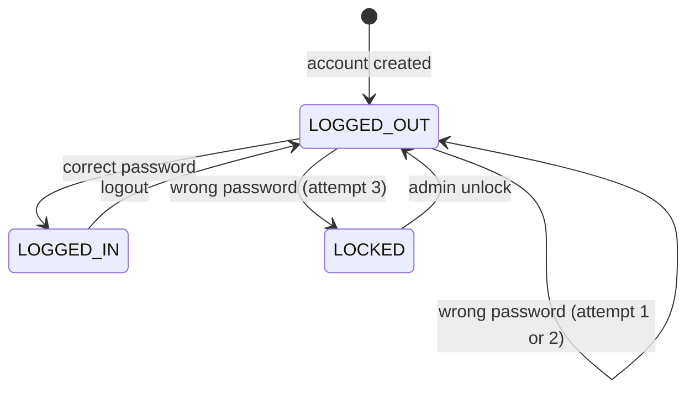

# State Transition Testing – Module M5 (Login and account lock)

The login feature behaves differently depending on its current state, so we model it as a state machine and test every valid transition and the important invalid ones.

## State diagram

## State transition table

| Current state | Event | Next state | Notes |
|---|---|---|---|
| LOGGED_OUT | Correct password | LOGGED_IN | Failed-attempt counter reset to 0 |
| LOGGED_OUT | Wrong password, attempts < 3 | LOGGED_OUT | Counter + 1 |
| LOGGED_OUT | Wrong password, 3rd in a row | LOCKED | |
| LOGGED_OUT | Logout | *invalid* | Error "Not logged in" |
| LOGGED_OUT | Unlock | *invalid* | Error "Account is not locked" |
| LOGGED_IN | Logout | LOGGED_OUT | |
| LOGGED_IN | Login | *invalid* | Error "Already logged in" |
| LOCKED | Any password | *invalid* | Error "Account is locked" |
| LOCKED | Admin unlock | LOGGED_OUT | Counter reset to 0 |

## Test cases

Test password: `Budget@2026`

| TC ID | Start state | Input / events | Expected end state / result | JUnit test |
|---|---|---|---|---|
| TC-ST-01 | LOGGED_OUT | Correct password | LOGGED_IN | `UserAccountTest.loginSuccess` |
| TC-ST-02 | LOGGED_OUT | 1 wrong password | LOGGED_OUT, attempts = 1 | `oneWrong` |
| TC-ST-03 | LOGGED_OUT | 3 wrong passwords | LOCKED | `lockAfterThree` |
| TC-ST-04 | LOGGED_OUT | 2 wrong, then correct | LOGGED_IN, attempts = 0 | `resetCounter` |
| TC-ST-05 | LOCKED | Correct password | Login refused ("Account is locked") | `lockedRefusesLogin` |
| TC-ST-06 | LOGGED_IN | Logout | LOGGED_OUT | `logout` |
| TC-ST-07 | LOCKED | Admin unlock, then correct password | LOGGED_OUT, then LOGGED_IN | `unlock` |
| TC-ST-08 | LOGGED_OUT | Logout | Refused ("Not logged in") | `logoutWhenLoggedOut` |
| TC-ST-09 | LOGGED_OUT | Unlock | Refused ("Account is not locked") | `unlockWhenNotLocked` |
| TC-ST-10 | LOGGED_IN | Login again | Refused ("Already logged in") | `loginTwice` |
| TC-ST-11 | – | Sign up with password "short" (5 chars) | Rejected (R16) | `shortPassword` |

**Coverage:** all 5 valid transitions and 4 invalid transitions are tested.
