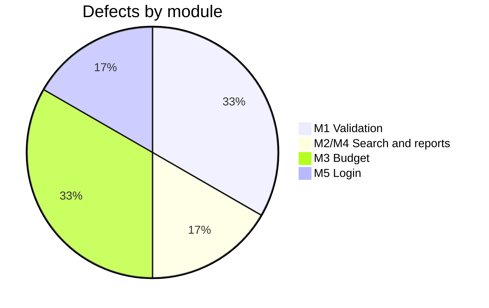

# Defect Reports

Found while running the test cases on **build v1.0** (10-11-2026). Fixed in **build v1.1** and retested. The code changes for all fixes are in [fixes_v1.0_to_v1.1.diff](fixes_v1.0_to_v1.1.diff).

**Reported by:** Ronnie Thomson · 10-11-2026 | **Fixed and retested by:** Shawn Avinash Robin

**Severity:** how badly the defect hurts the user. **Priority:** how soon it must be fixed.

## Defect summary

| ID | Title | Module | Found by | Severity | Priority | Status |
|---|---|---|---|---|---|---|
| DEF-001 | Maximum amount 1,000,000.00 is rejected | M1 | BVA | Medium | Medium | Closed |
| DEF-002 | Description with only spaces is accepted | M1 | EP | Low | Medium | Closed |
| DEF-003 | Date range search leaves out the end date, so monthly reports miss the last day | M2, M4 | Functional | **High** | **High** | Closed |
| DEF-004 | Spending exactly 100 % of budget shows "Exceeded" instead of "Warning" | M3 | BVA | Medium | Medium | Closed |
| DEF-005 | Rounding makes 79.999 % show as "Warning" and 99.999 % as "Exceeded" | M3 | BVA | Medium | Medium | Closed |
| DEF-006 | Account locks after the 4th wrong password instead of the 3rd | M5 | State Transition | **High** | **High** | Closed |

---

## DEF-001 – Maximum amount 1,000,000.00 is rejected

| Field | Detail |
|---|---|
| Module | M1 Expense input validation |
| Requirement | R1: amount 0.01 to 1,000,000.00 **inclusive** |
| Test case | TC-BVA-05 |
| Build found / fixed | v1.0 / v1.1 |
| Severity / Priority | Medium / Medium |

**Steps to reproduce**
1. Add an expense: amount 1000000.00, category RENT, description "House deposit", today's date.

**Expected:** expense is saved.
**Actual:** error "Amount must be between 0.01 and 1,000,000.00" even though the amount is exactly the allowed maximum.

**Root cause:** `ExpenseValidator` checked `amount >= MAX_AMOUNT` instead of `amount > MAX_AMOUNT` (off-by-one at the upper boundary).
**Fix:** changed the check to `> MAX_AMOUNT`.
**Retest (v1.1):** TC-BVA-04, 05, 06 pass – PASS. Status: **Closed**.

---

## DEF-002 – Description with only spaces is accepted

| Field | Detail |
|---|---|
| Module | M1 Expense input validation |
| Requirement | R2: description required; spaces only not allowed |
| Test case | TC-EP-08 |
| Build found / fixed | v1.0 / v1.1 |
| Severity / Priority | Low / Medium |

**Steps to reproduce**
1. Add an expense: amount 10.00, FOOD, description `"    "` (4 spaces), today.

**Expected:** error "Description is required".
**Actual:** expense is saved with an empty description (the spaces are trimmed after validation), so it shows as a blank row in the list.

**Root cause:** used `isEmpty()`, which is false for a string of spaces. The length check also counted the spaces at the ends.
**Fix:** use `isBlank()`, and check the length after trimming.
**Retest (v1.1):** TC-EP-07, TC-EP-08, TC-BVA-07, TC-BVA-08 pass. Status: **Closed**.

---

## DEF-003 – Date range search leaves out the end date, so monthly reports miss the last day

| Field | Detail |
|---|---|
| Module | M2 Manage expenses (cause), M4 Reports (impact) |
| Requirement | R7: start and end dates both included; R11: monthly report includes every day |
| Test cases | TC-FN-09, TC-RP-01, TC-RP-02, TC-RP-03, TC-RP-04 |
| Build found / fixed | v1.0 / v1.1 |
| Severity / Priority | **High / High** – reports show wrong totals and wrong savings |

**Steps to reproduce**
1. Add a Restaurant expense of 1,499.50 on 31-10-2026 (plus the other October test data).
2. Open the monthly report for October 2026.

**Expected:** total 17,800.00, FOOD 5,000.00, savings 7,200.00 (28.80 %) on income 25,000.00.
**Actual:** total 16,300.50, FOOD 3,500.50, savings 8,699.50 (34.80 %). The expense on 31-10 is missing, so the user thinks they saved 1,499.50 more than they did.

**Root cause:** `ExpenseTracker.findBetween` used `date.isBefore(end)`, which excludes the end date. The report uses this method with the last day of the month as `end`.
**Fix:** changed to `!date.isAfter(end)`.
**Retest (v1.1):** all 5 test cases pass. Status: **Closed**.

---

## DEF-004 – Spending exactly 100 % of budget shows "Exceeded"

| Field | Detail |
|---|---|
| Module | M3 Budget and alerts |
| Requirement | R9: Warning for 80 % – 100 % inclusive; Exceeded only above 100 % |
| Test case | TC-BVA-10e |
| Build found / fixed | v1.0 / v1.1 |
| Severity / Priority | Medium / Medium |

**Steps to reproduce**
1. Set FOOD budget for October 2026 to 1000.00.
2. Add a FOOD expense of 1000.00 in October.
3. Check the budget status.

**Expected:** WARNING (the user is at the limit, not over it).
**Actual:** EXCEEDED.

**Root cause:** condition was `percent >= 100` instead of `percent > 100`.
**Fix:** status logic rewritten to compare exact amounts (see DEF-005); EXCEEDED only when spent > limit.
**Retest (v1.1):** TC-BVA-10e and 10f pass. Status: **Closed**.

---

## DEF-005 – Rounding makes 79.999 % show as "Warning" and 99.999 % as "Exceeded"

| Field | Detail |
|---|---|
| Module | M3 Budget and alerts |
| Requirement | R9 |
| Test cases | TC-BVA-10a, TC-BVA-10d |
| Build found / fixed | v1.0 / v1.1 |
| Severity / Priority | Medium / Medium |

**Steps to reproduce**
1. Set FOOD budget for October 2026 to 1000.00.
2. Add a FOOD expense of 799.99. Check status. Then try with 999.99.

**Expected:** 799.99 → WITHIN; 999.99 → WARNING.
**Actual:** 799.99 → WARNING; 999.99 → EXCEEDED.

**Root cause:** the status was decided from the percentage **after rounding to 2 decimals** (79.999 % → 80.00 %, 99.999 % → 100.00 %). This defect was only found because BVA tests the value just below each boundary.
**Fix:** decide the status by comparing the exact amounts (`spent × 100` against `limit × 80` and `limit × 100`); rounding is used only for display.
**Retest (v1.1):** all 6 TC-BVA-10 cases pass. Status: **Closed**.

---

## DEF-006 – Account locks after the 4th wrong password instead of the 3rd

| Field | Detail |
|---|---|
| Module | M5 Login and account lock |
| Requirement | R14: 3 wrong passwords in a row lock the account |
| Test cases | TC-ST-03, TC-ST-05, TC-ST-07 |
| Build found / fixed | v1.0 / v1.1 |
| Severity / Priority | **High / High** – security: attackers get an extra guess |

**Steps to reproduce**
1. Create account `student01` with password `Budget@2026`.
2. Log in with a wrong password 3 times.
3. Check the account state, then try the correct password.

**Expected:** state LOCKED after the 3rd wrong password; correct password refused.
**Actual:** state is still LOGGED_OUT; the correct password logs in. The account only locks after a 4th wrong password. Because it never locked, the admin "unlock" step also failed with "Account is not locked".

**Root cause:** `failedAttempts > MAX_FAILED_ATTEMPTS` instead of `>=`.
**Fix:** changed to `>=`.
**Retest (v1.1):** all 11 TC-ST cases pass. Status: **Closed**.
