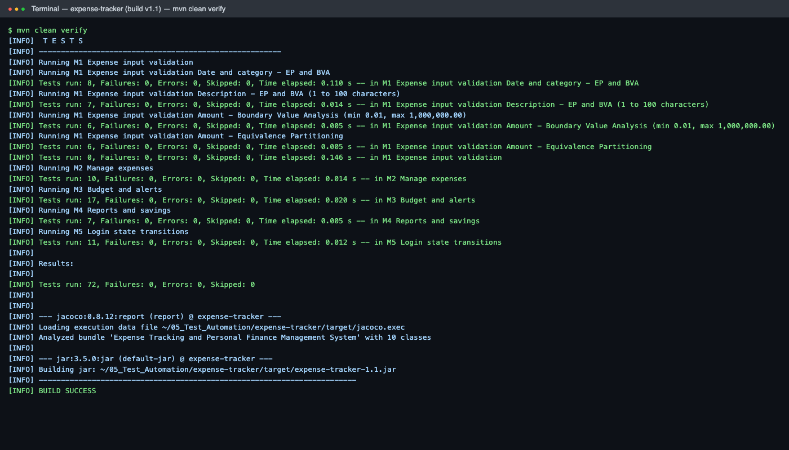
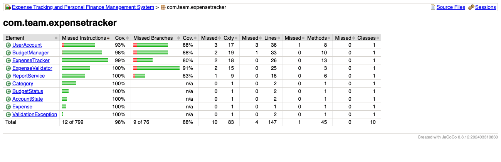
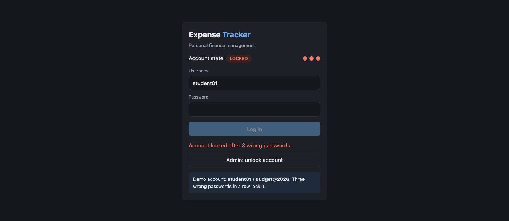
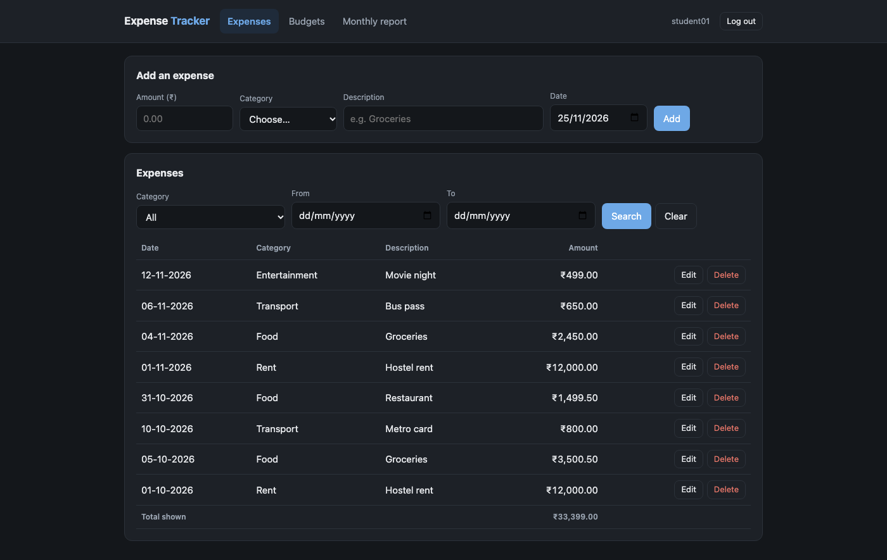
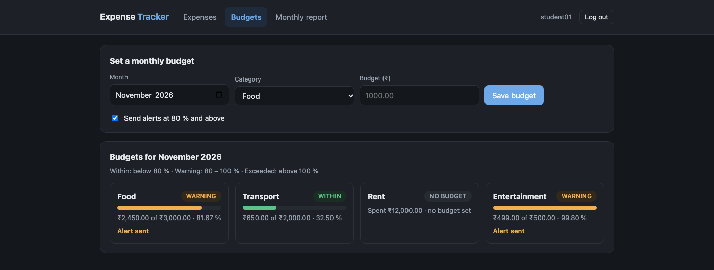
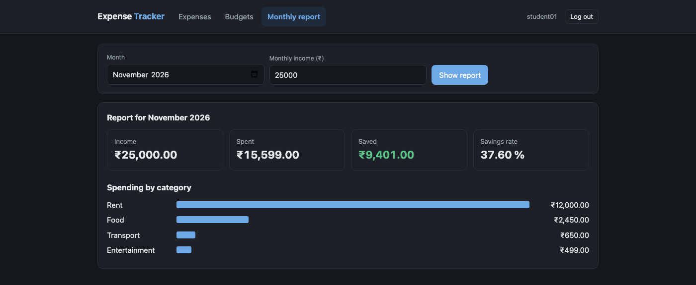

# Screenshots

Screenshots 01–07 come from real runs of the test suite (`mvn clean test` on build v1.0, `mvn clean verify` on build v1.1).

| Screenshot | What it shows |
|---|---|
| [01_repo_home.png](01_repo_home.png) | GitHub repository home page with the folder structure and README |
| [02_v1.0_test_run_failures.png](02_v1.0_test_run_failures.png) | Build v1.0: **Tests run: 72, Failures: 12, Errors: 1** – the failures that led to DEF-001 to DEF-006 |
| [03_v1.0_failure_detail_TC-ST-03.png](03_v1.0_failure_detail_TC-ST-03.png) | One failure in detail: TC-ST-03 expected `LOCKED` but was `LOGGED_OUT` (DEF-006) |
| [04_v1.1_test_run_all_pass.png](04_v1.1_test_run_all_pass.png) | Build v1.1 retest: **Tests run: 72, Failures: 0** and BUILD SUCCESS, module by module |
| [05_jacoco_coverage_by_class.png](05_jacoco_coverage_by_class.png) | JaCoCo coverage per class – 98 % instructions, 88 % branches |
| [06_jacoco_BudgetManager_line_coverage.png](06_jacoco_BudgetManager_line_coverage.png) | Line-by-line coverage of `BudgetManager` (green = tested, red = not tested, yellow = some branches missed) |
| [07_commit_history.png](07_commit_history.png) | GitHub commit history showing the project's progress |
| [08_webapp_login.png](08_webapp_login.png) | Web app login screen, account state LOGGED_OUT (M5) |
| [09_webapp_account_locked.png](09_webapp_account_locked.png) | After 3 wrong passwords the state is LOCKED and login is disabled; admin unlock is offered (R14, R15 – the DEF-006 rule) |
| [10_webapp_expenses.png](10_webapp_expenses.png) | Expenses screen: add form, filter and date-range search, list with edit and delete (M1, M2) |
| [11_webapp_budgets.png](11_webapp_budgets.png) | Budgets for the month with Within / Warning / No budget status and alerts (M3) |
| [12_webapp_monthly_report.png](12_webapp_monthly_report.png) | Monthly report: spent, saved, savings rate and spending by category (M4) |

### Build v1.0 – failures

### Build v1.1 – all tests pass

### Coverage

### Web app (08_Frontend)
The web app runs on the same Java classes that the tests check, so these screens show the tested rules in use.

