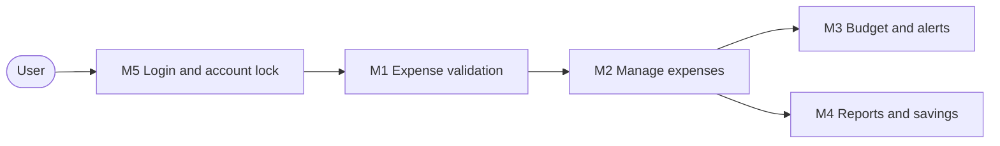

# Software Testing Portfolio
## Expense Tracking and Personal Finance Management System

| | |
|---|---|
| **Subject** | Software Testing |
| **Component** | Other Component – Online Portfolio using GitHub Activity |
| **Application under test** | Expense Tracking and Personal Finance Management System (v1.0 tested, v1.1 retested) |
| **Academic year** | 2026–27 |

### Team members

| # | Name | Roll / Register No. | Role in the project |
|---|---|---|---|
| 1 | Shawn Avinash Robin | 1MS23IS114 | Test lead – test plan, JUnit automation, coverage, summary report |
| 2 | Ronnie Thomson | 1MS23IS103 | Test designer – EP, BVA, defect reports, documentary |
| 3 | SriHari | 1MS23IS121 | Test designer – decision table, state transition, functional test cases |

---

## Objectives

1. Understand the application and split it into testable modules.
2. Prepare a test plan that sets the scope, approach, schedule, and entry/exit criteria.
3. Design test cases using **Equivalence Partitioning, Boundary Value Analysis, Decision Table** and **State Transition** testing.
4. Run the test cases, record actual results, and find and report defects.
5. Automate the test cases with **JUnit 5** and measure code coverage with **JaCoCo**.
6. Retest the fixed build and write a test execution summary.

## Project description

The **Expense Tracking and Personal Finance Management System** helps a user record daily spending, group it into categories, set a monthly budget for each category, get an alert when spending gets close to the budget, and see monthly reports with savings. Login is protected and the account locks after repeated wrong passwords.

The application's business logic is written in Java (folder [`05_Test_Automation/expense-tracker`](05_Test_Automation/expense-tracker)). It is the system under test.

### Modules under test

| ID | Module | What it does | Main technique used |
|---|---|---|---|
| M1 | Add Expense – input validation | Checks amount, description, date and category | Equivalence Partitioning, BVA |
| M2 | Manage Expenses | Add, edit, delete, filter by category, search by date range | Functional / EP |
| M3 | Budget and Alerts | Monthly budget per category, status (Within / Warning / Exceeded), alert decision | Decision Table, BVA |
| M4 | Reports and Savings | Monthly total, category breakdown, savings and savings rate | Functional |
| M5 | Login and Account Lock | Login, logout, lock after 3 wrong passwords, admin unlock | State Transition |



## Results at a glance

| | Build v1.0 (first run) | Build v1.1 (retest) |
|---|---|---|
| Test cases run | 72 | 72 |
| Passed | 59 | **72** |
| Failed | 13 | **0** |
| Defects open | 6 | **0** |
| Line coverage (JaCoCo) | – | **97.3 %** (143 / 147) |
| Branch coverage (JaCoCo) | – | **88.2 %** (67 / 76) |

## Repository structure

| Folder | Contents |
|---|---|
| [01_Test_Plan](01_Test_Plan) | Test plan (scope, approach, schedule, entry/exit criteria, risks) |
| [02_Test_Case_Design](02_Test_Case_Design) | Test cases designed with EP, BVA, decision table, state transition, plus functional test cases |
| [03_Test_Execution](03_Test_Execution) | Execution results for build v1.0 with the raw Maven log and JUnit XML results |
| [04_Defect_Reports](04_Defect_Reports) | Six defect reports and the code fixes |
| [05_Test_Automation](05_Test_Automation) | Application source code, JUnit 5 test scripts, how to run them |
| [06_Test_Reports](06_Test_Reports) | Test execution summary, retest log, JaCoCo coverage report |
| [07_Screenshots](07_Screenshots) | Screenshots of test runs and reports |
| [Conclusion.md](Conclusion.md) | What we learned and the final result |

## How to run the tests

Requirements: Java 17 or newer and Maven 3.8 or newer.....

```bash
cd 05_Test_Automation/expense-tracker
mvn clean verify
```

The coverage report is created at `target/site/jacoco/index.html`.
